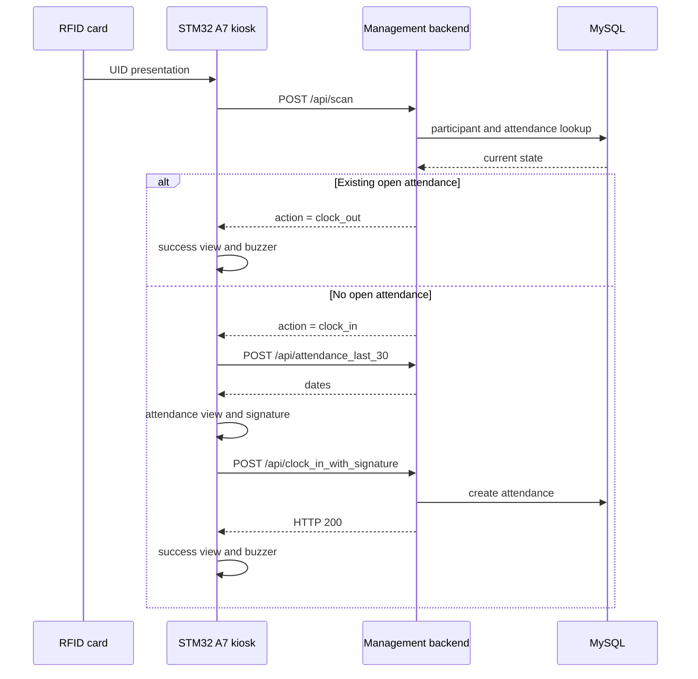

# Management backend integration

This document is the contract between the STM32 A7 device and the separate
`Bits-Bytes-management-platform` backend. It describes only the interface the
device needs; it does not copy backend source code, MySQL data or secrets into
this repository.

## Ownership boundary

| System | Owns |
|---|---|
| STM32 device | RFID acquisition, touchscreen workflow, signature capture, buzzer feedback, Wi-Fi setup and HTTPS client |
| Management backend | API routes, API-key permission policy, participants, attendance records, signatures and MySQL access |

The device uses HTTPS only. It must not receive MySQL credentials or connect
directly to the database.

## Device configuration

The board stores the API base URL in `/etc/clockin-device/environment` and reads
the API key from a separate root-only file:

```ini
BITS_BYTES_API_BASE_URL=https://management-acc.bitsenbytes.net
BITS_BYTES_API_KEY_FILE=/etc/clockin-device/rfid-api-key
BITS_BYTES_ADMIN_PIN_FILE=/etc/clockin-device/admin-pin
```

The client sends the API key exactly as the `Authorization` header value. Do not
prepend `Bearer ` unless the backend and client authentication design are both
changed and tested together.

The current staging endpoint is `https://management-acc.bitsenbytes.net`. If it
is intentionally offline, the kiosk stays responsive but cannot complete an
attendance request. That is an API availability state, not an RFID, buzzer or
display failure.

## Required HTTP contract

All request bodies are JSON. The client sends `Accept: application/json`,
`Content-Type: application/json`, its API key in `Authorization`, and the user
agent `bits-bytes-stm32-rfid/3.0`.

| Purpose | Request | Successful response consumed by the device | Required backend permission |
|---|---|---|---|
| Health | `GET /api/health` | HTTP 200 | none |
| Scan card | `POST /api/scan` with `{"rfid_uid":"A1B2C3D4"}` | `{"success":true,"action":"clock_in"\|"clock_out","message":"…","user":{"name":"…","department":"…"}}` | `attendance.scan` |
| Recent attendance | `POST /api/attendance_last_30` with `{"rfid_uid":"A1B2C3D4"}` | `{"dates":["YYYY-MM-DD","…"]}` | `attendance.list` |
| Clock in with signature | `POST /api/clock_in_with_signature` with `{"rfid_uid":"A1B2C3D4","signature":"<svg …>"}` | HTTP 200 | `attendance.clock_in` |

The device normalizes its RFID UID before transmission. Keep participant RFID
records compatible with that normalized value.

Expected error handling:

| Response | Device behaviour |
|---|---|
| HTTP 404 from `/api/scan` | Shows `Kaart niet geregistreerd` |
| HTTP 401, 403 or 423 | Shows API authorization failure |
| Other non-200 response | Shows `Serverfout (HTTP nnn)` |
| Transport failure before a request is sent | Shows API connection failure |
| 5xx or lost response after scan/signature was sent | Marks the result uncertain and does not automatically retry |

The last rule prevents duplicate clock-ins/outs when the server may already
have stored the operation but its response did not reach the device.

## Attendance sequence



The local card-presence tracker makes one event per presentation and requires
the card to be removed before another workflow can start. Backend validation is
still authoritative.

## Backend development and MySQL

The management-platform source is a separate checkout. Its backend package
currently provides these normal development commands:

```bash
cd /path/to/Bits-Bytes-management-platform/backend
npm ci
npm run build
npm test
npm run start
```

`npm run start` loads local backend environment configuration. Those `.env`
files and their values are backend secrets/configuration; never copy them into
this device repository.

For a local MySQL setup, configure the platform backend for `DATABASE_TYPE=mysql`
and provide the database host, port, user, password and database names through
its secure environment configuration. The backend owns migration execution and
MySQL connectivity. The STM32 changes only `CLOCKIN_API_BASE_URL` to reach that
backend and then restarts `clockin-device.service`.

Production is managed by the platform repository's container/Kubernetes
configuration. Its HTTPS ingress must route `/api/*` to the backend service.
The browser frontend is not required by the STM32, but backend availability and
the MySQL service are.

## Provision an API key

Create a distinct device API key and grant the minimum permissions:

```text
attendance.scan
attendance.list
attendance.clock_in
```

Deploy that value only through `CLOCKIN_API_KEY` or another protected board
configuration procedure. On rotation or revocation, update the protected file
and restart the kiosk. Never put the value in a source file, systemd unit, log,
screenshot, chat message or Git commit.

## Fault isolation

Work from hardware outward:

1. Confirm the app reports `MFRC522 ready on /dev/spidev0.0`.
2. Confirm Wi-Fi/DHCP in the admin network screen or with `wpa_cli`.
3. Confirm API health from the board without printing any secret:

   ```bash
   ssh root@10.10.1.20 'curl -fsS --connect-timeout 5 -o /dev/null -w "%{http_code}\n" https://management-acc.bitsenbytes.net/api/health'
   ```

4. If this is not HTTP 200, inspect the reverse proxy, backend runtime and
   MySQL from the management-platform/infrastructure side.
5. If health works but a scan is rejected, inspect API-key permissions,
   participant RFID data and backend validation logs.

The device checks health every 60 seconds while online and every 15 seconds
while offline. Its render thread, touch input, RFID worker and Wi-Fi controls
must remain responsive during an outage.

## Security rules

- Use HTTPS with a valid certificate for every production API address.
- Keep API keys, database credentials, Wi-Fi passwords, JWT material and
  encryption keys out of Git and operational screenshots.
- Use the platform's approved secret-management mechanism for deployment.
- Rotate a secret if it was ever committed, copied to a public log or shared
  accidentally.
- Treat a backend contract change as a coordinated backend/device release.
