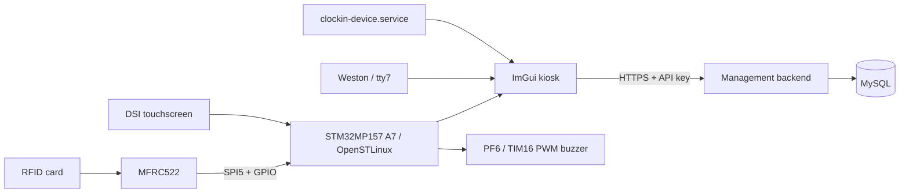

# STM32MP157F-DK2 setup from scratch

This is the operational guide for turning a fresh STM32MP157F-DK2 into the A7
clock-in kiosk. It covers the A7 ImGui application, RFID reader, buzzer,
touchscreen, Wi-Fi administration, backend connection and boot-persistent
kiosk mode.

All product functionality runs on the Cortex-A7 under OpenSTLinux. The legacy
Cortex-M4 firmware and `/dev/ttyRPMSG0` are not part of normal operation.

> Keep a serial console or ST-LINK attached for the first boot-resource
> deployment. A bad device tree or boot menu can affect SSH and display output.
> The saved stock-M4 boot entry is the recovery path.

## System boundary

| Component | Source of truth | Responsibility |
|---|---|---|
| Device application | This `attendance-device` repository | ImGui UI, touch, RFID, buzzer, Wi-Fi UI, HTTP client and kiosk service |
| Board resources | `board/` in this repository | Device tree, boot menu, systemd units and recovery helpers |
| Management platform | Separate `Bits-Bytes-management-platform` repository | Attendance API, MySQL, participant data, API-key permissions and browser UI |
| Device secrets | `/etc/clockin-device/` on the board | API key, administrator PIN and runtime configuration |

The device talks to the backend over HTTPS. It never connects to MySQL directly
and this repository intentionally does not contain the website/backend source.



## 1. Prerequisites

Have the following before you start:

- STM32MP157F-DK2 running the matching OpenSTLinux 5.0.8 image.
- MFRC522 and buzzer wired as documented in [board/README.md](../board/README.md).
- SSH access as `root`; examples use `root@10.10.1.20`.
- Serial or ST-LINK recovery for the first A7 boot change.
- Windows with WSL 2 and Ubuntu 24.04.
- WSL packages: `git`, `cmake`, `build-essential`, `file` and `binutils`.
- The matching OpenSTLinux 5.0.8 STM32MP1 SDK below `/opt/st/stm32mp1`.
- A backend URL, device API key and four-digit local administrator PIN.

Install build prerequisites in WSL:

```bash
sudo apt update
sudo apt install -y git cmake build-essential file binutils
```

## 2. Clone the source and build it

Clone this branch on a new build machine:

```bash
git clone --branch docs/a7-kiosk-complete-guide \
  https://github.com/BitsEnBytesICT/attendance-device.git
cd attendance-device
```

Install the target SDK using ST's installer. If the SDK environment script is
not below `/opt/st/stm32mp1`, set it explicitly:

```bash
export STM32_SDK_ENV=/absolute/path/to/environment-setup-cortexa7t2hf-neon-vfpv4-ostl-linux-gnueabi
```

Run tests and produce the ARM binaries:

```bash
bash scripts/test-host.sh
bash scripts/build-arm.sh
```

The headless tests create no desktop window. ARM outputs go outside the source
tree, normally to:

```text
~/.cache/clockin-device/arm/clockin-device
~/.cache/clockin-device/arm/clockin-hardware-diagnostic
```

## 3. Give the A7 ownership of RFID and buzzer

The A7 device tree assigns these exact signals to Linux:

| Hardware | Signal | STM32 pin | Linux use |
|---|---|---:|---|
| MFRC522 | MOSI | PF9, AF5 | SPI5 |
| MFRC522 | MISO | PF8, AF5 | SPI5 |
| MFRC522 | SCK | PH6, AF5 | SPI5 |
| MFRC522 | chip select | PD14 | active-low GPIO |
| MFRC522 | reset | PD15 | libgpiod output |
| Buzzer | PWM | PF6, AF1 | TIM16 channel 1 |

PH6 is intentional. Do not replace it with PF7 unless the physical clock wire
also moves. The full connector and power mapping is in
[board/README.md](../board/README.md).

The A7 boot entry masks `m4-autostart.service` so the M4 cannot claim the same
pins. The app then uses `/dev/spidev0.0`, GPIO and PWM directly; it must never
open `/dev/ttyRPMSG0`.

## 4. Install A7 boot resources

Do this only for a stock board or when the A7 configuration has not been
installed before.

1. Copy the exact stock DTB from the target board image to:

   ```text
   board/device-tree/build/stm32mp157f-dk2-stock.dtb
   ```

2. Build the merged A7 DTB:

   ```bash
   bash board/device-tree/build-device-tree.sh
   ```

3. With serial recovery available, deploy the boot resources:

   ```bash
   bash scripts/deploy-a7-boot.sh root@10.10.1.20
   ```

4. Reboot and choose `clockin-a7-test` from the serial menu. The `stock-m4`
   option remains available for recovery.

Verify the result:

```bash
ssh root@10.10.1.20 'cat /proc/cmdline'
ssh root@10.10.1.20 'ls -l /dev/spidev* /sys/class/pwm/pwmchip*'
ssh root@10.10.1.20 'systemctl is-enabled m4-autostart.service || true'
```

The kernel command line must contain `systemd.mask=m4-autostart.service`, and
a SPI device plus PWM chip must exist. If the A7 boot path fails, restore the
saved stock menu:

```bash
bash scripts/rollback-stock-boot.sh root@10.10.1.20
```

## 5. Enable the Wi-Fi control socket once

The admin Wi-Fi page keeps OpenSTLinux's existing `wpa_supplicant@wlan0.service`
and `udhcpc-wlan0.service`. It needs the protected local control socket once:

```bash
bash scripts/migrate-network-control.sh root@10.10.1.20
```

Run it with serial or fallback access available. It validates association and
DHCP before it keeps its configuration; otherwise it automatically rolls back.
See [NETWORKING.md](NETWORKING.md) before changing a production Wi-Fi profile.

## 6. Configure and deploy the kiosk

For the first deployment, provide configuration only in the current terminal:

```bash
export CLOCKIN_API_BASE_URL='https://management-acc.bitsenbytes.net'
export CLOCKIN_API_KEY='DEVICE_API_KEY_GOES_HERE'
export CLOCKIN_ADMIN_PIN='1234'

bash scripts/deploy.sh root@10.10.1.20

unset CLOCKIN_API_KEY CLOCKIN_ADMIN_PIN
```

The script writes these root-owned mode-`0600` files:

```text
/etc/clockin-device/environment
/etc/clockin-device/rfid-api-key
/etc/clockin-device/admin-pin
```

Later deployments preserve them when the environment variables are omitted.
Never put keys, PINs, Wi-Fi passwords, DTBs or binaries into Git.

The script installs the application, hardware diagnostic, systemd service,
Weston terminal drop-in and a vendor-demo suppression file. It also disables
the legacy `imgui-app.service` and M4 service.

## 7. Kiosk boot sequence

1. Weston starts on the board.
2. The project drop-in selects `tty7` **before** Weston creates its DRM/input
   session.
3. The project configuration suppresses the OpenSTLinux demo/home launcher.
4. Weston exposes `/run/user/1000/wayland-0`.
5. `clockin-device.service` waits for that socket, then starts fullscreen ImGui.
6. systemd restarts an unexpected application exit after five seconds.

The terminal timing matters: do not run `chvt 7` after Weston is already live.
That can deactivate the compositor's seat and leave the panel black.

Verify a healthy kiosk:

```bash
ssh root@10.10.1.20 'systemctl is-enabled clockin-device.service'
ssh root@10.10.1.20 'systemctl show clockin-device.service -p ActiveState -p SubState -p Restart -p NRestarts'
ssh root@10.10.1.20 'loginctl list-sessions --no-legend; cat /sys/class/tty/tty0/active'
```

The application and Weston should be active, `Restart=always`, and `tty7`
should be active. If the panel shows the ST home/demo page, run:

```bash
ssh root@10.10.1.20 'systemctl restart weston-graphical-session.service && systemctl restart clockin-device.service'
```

## 8. Validate hardware

Check the journal and reader:

```bash
ssh root@10.10.1.20 'journalctl -u clockin-device.service -b --no-pager -n 100'
ssh root@10.10.1.20 '/usr/local/bin/clockin-hardware-diagnostic --rfid-only --rfid-seconds=60'
```

Present a known card during the RFID test. A normal MFRC522 version is commonly
`0x91` or `0x92`; `0x00` or `0xFF` means check power, wiring and pin ownership.

The buzzer test makes audible sound, so run it only when somebody can confirm
it:

```bash
ssh root@10.10.1.20 '/usr/local/bin/clockin-hardware-diagnostic --buzzer-only'
```

The application journal should report `MFRC522 ready on /dev/spidev0.0`. A
message mentioning `/dev/ttyRPMSG0` belongs to the obsolete M4/RPMsg program.

## 9. Backend and attendance flow

The card reader emits one UID event per presentation. The GUI sends
`POST /api/scan`; a clock-out completes immediately, while a clock-in loads the
attendance list, asks for a signature, then sends the SVG to
`POST /api/clock_in_with_signature`.

The backend decides participant validity and attendance state. The device does
not retry a side-effecting request automatically after a lost response, so it
cannot silently create duplicate or reversed attendance entries. Read
[BACKEND_INTEGRATION.md](BACKEND_INTEGRATION.md) for the exact API and
permission contract.

An intentionally offline backend leaves the UI, touch and RFID worker
responsive. Until `/api/health` returns HTTP 200, card attendance cannot be
completed.

## 10. Daily operations and release checks

| Task | Command |
|---|---|
| Follow kiosk log | `ssh root@10.10.1.20 'journalctl -u clockin-device.service -f'` |
| Restart kiosk | `ssh root@10.10.1.20 'systemctl restart clockin-device.service'` |
| Restart display and kiosk | `ssh root@10.10.1.20 'systemctl restart weston-graphical-session.service && systemctl restart clockin-device.service'` |
| Stop kiosk intentionally | `ssh root@10.10.1.20 'systemctl stop clockin-device.service'` |
| Reboot board | `ssh root@10.10.1.20 'systemctl reboot'` |

Before release, verify:

- [ ] Host tests and ARM build pass.
- [ ] Three cold boots show ImGui rather than the ST home/demo page.
- [ ] Weston uses `tty7`; no black panel appears.
- [ ] RFID reads a stable UID once per presentation.
- [ ] Buzzer is audible and turns off after every cue.
- [ ] Touchscreen and signature pad work across the screen.
- [ ] An authorized card can clock in, sign and clock out when the API is online.
- [ ] No credential or generated artifact is staged in Git.

## Documentation map

- [README.md](../README.md): repository overview and quick start.
- [src/README.md](../src/README.md): ImGui/frontend source responsibilities.
- [board/README.md](../board/README.md): wiring, device tree and board runtime.
- [scripts/README.md](../scripts/README.md): script purpose and safe order.
- [BACKEND_INTEGRATION.md](BACKEND_INTEGRATION.md): API and backend ownership.
- [OPERATIONS.md](OPERATIONS.md): detailed live diagnosis and rollback.
